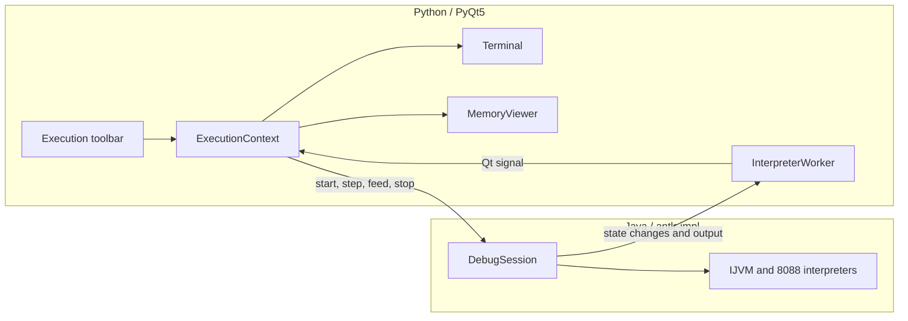

<div align="center">

# Assembly-UI

**A desktop IDE and step-by-step debugger for IJVM and Intel 8088 assembly.**

Assembly UI for UniCA's ARE course. Part of the "Assembly Stdio" project.


[Features](#features) · [Getting started](#getting-started) · [Debugging](#debugging-a-program) · [Architecture](#architecture) · [Interpreter](#updating-the-interpreter)

</div>

---

## Features

| Area | What it does |
| --- | --- |
| **Editor** | Syntax highlighting, tabs, search, zoom, and automatic saving |
| **Execution** | Run a program, or debug it one instruction at a time |
| **Automatic stepping** | Execute one instruction every 500 ms to 10 s |
| **Memory viewer** | Live registers, stack, memory, flags, constants, and call frames |
| **Terminal** | Program output, interactive input, search, and error reports |
| **Desktop** | Custom window frame for macOS, Linux, and Windows |

### Supported languages

| Language | File extensions | Memory viewer contexts |
| --- | --- | --- |
| **IJVM** | `.jas`, `.ijvm` | Constants, call frames with locals and operand stack |
| **Intel 8088** | `.asm`, `.a8088` | Registers, stack, memory, flags |

## Getting started

### Requirements

- Python 3.9 or later
- A Java runtime, version 11 or later

The application finds Java through `JAVA_HOME` or through the `java` command on `PATH`.

### Install and run

With [uv](https://docs.astral.sh/uv/):

```bash
git clone https://github.com/MarkTheRealCoder/Assembly-UI.git
cd Assembly-UI
uv sync
uv run python main.py
```

With `pip`:

```bash
git clone https://github.com/MarkTheRealCoder/Assembly-UI.git
cd Assembly-UI
python -m venv .venv
source .venv/bin/activate      # Windows: .venv\Scripts\activate
pip install -r requirements.txt
python main.py
```

## Debugging a program

1. Open or create a source file.
2. Select **Run** to execute the program, or **Debug** to pause before the first instruction.
3. In debug mode, step ahead by **1** or **10** instructions, or start automatic stepping.
4. When the program asks for input, type a line in the terminal and press <kbd>Enter</kbd>.
5. Select **Stop** to end the program at any time.

> [!NOTE]
> The program reads the first character of each input line. The UI and the command-line interpreter use the same rule.

### Display limits

The limits keep the interface responsive during long executions. They do not change the program state.

| Item | Limit |
| --- | --- |
| Call frames shown | 16 most recent |
| Stack entries shown | 64 most recent per frame |
| Non-zero memory bytes shown | 128 |
| Terminal output | 200,000 characters per run |
| Java heap | 256 MB |

## Architecture



The UI loads the interpreter in-process through [JPype](https://jpype.readthedocs.io/). The program runs on its own Java thread, and the session sends only the values that changed since the previous update.

### Project structure

```text
Assembly-UI/
├── main.py                 Application entry point
├── resources/
│   ├── antlr_lexers/       Interpreter JAR and lexer grammars
│   ├── external/           Built-in language guides
│   └── styles/             Qt style sheets
└── source/
    ├── asyncro/            Background scheduling
    ├── comms/              Events and signals
    ├── filesystem/         Documents, file types, and paths
    ├── interface/
    │   ├── debugger/       Terminal, memory viewer, and execution toolbar
    │   ├── editor/         Code editor, lexers, and tabs
    │   ├── modals/         Dialogs and file manager
    │   ├── templates/      Shared widgets and window frames
    │   └── titlebar/       Application title bar
    ├── interpreter/        JPype connection to the Java interpreter
    └── platform/           Operating system integration
```

## Updating the interpreter

The interpreter lives in [atom7xyz/antlr-impl](https://github.com/atom7xyz/antlr-impl). Build it with Maven and replace the bundled JAR:

```bash
git clone https://github.com/atom7xyz/antlr-impl.git
cd antlr-impl
mvn clean package
cp target/antlr-impl-1.0.0-jar-with-dependencies.jar ../Assembly-UI/resources/antlr_lexers/interpreter.jar
```

To use a different JAR without replacing the bundled one, set this value in `settings.ini`:

```ini
[editor]
interpreter=/path/to/interpreter.jar
```

## License

Distributed under the [MIT License](LICENSE).
