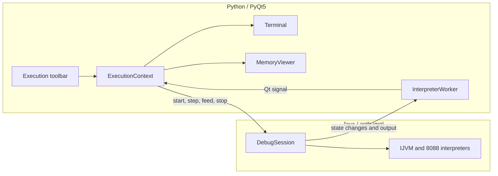

<div align="center">

# Assembly-UI

**A desktop IDE and step-by-step debugger for IJVM and Intel 8088 assembly.**

Assembly UI for UniCA's ARE course. Part of the "Assembly Stdio" project.


[Features](#features) · [Getting started](#getting-started) · [Debugging](#debugging-a-program) · [Architecture](#architecture) · [Interpreter](#updating-the-interpreter)

</div>

---

## Features

| Area | What it does |
| --- | --- |
| **Editor** | Syntax highlighting, tabs, search, zoom, and automatic saving, in the bundled JetBrains Mono font |
| **Error highlighting** | After a run, the syntax, semantic, and runtime errors of the interpreter are underlined in the editor, with a margin marker and a tooltip |
| **Autocompletion** | Keywords and the labels, constants, methods, and variables declared in the file, never inside comments or strings |
| **Execution** | Run a program, or debug it one instruction at a time |
| **Automatic stepping** | Execute one instruction every 500 ms to 10 s |
| **Memory viewer** | Live registers, stack, memory, flags, constants, and nested call frames with addresses, in hexadecimal, decimal, or octal. Double-click a value to copy it, or show it as an ASCII character |
| **Terminal** | Program output, interactive input, search, and tagged messages |
| **Desktop** | Custom window frame for macOS, Linux, and Windows. The app restores the open files, the window size and maximized state, and the position of the panel splitters |

### Supported languages

| Language | File extensions | Memory viewer contexts |
| --- | --- | --- |
| **IJVM** | `.jas`, `.ijvm` | Constants, and a stack of call frames: variables, then the operand stack by word address, then the called method |
| **Intel 8088** | `.asm`, `.a8088` | Registers, stack with one group per active `CALL`, memory, flags |

## Getting started

### Requirements

- Python 3.9 or later
- A Java runtime, version 11 or later

The application finds Java through `JAVA_HOME` or through the `java` command on `PATH`.

### Install and run

With [uv](https://docs.astral.sh/uv/):

```bash
git clone https://github.com/MarkTheRealCoder/Assembly-UI.git
cd Assembly-UI
uv sync
uv run python main.py
```

With `pip`:

```bash
git clone https://github.com/MarkTheRealCoder/Assembly-UI.git
cd Assembly-UI
python -m venv .venv
source .venv/bin/activate      # Windows: .venv\Scripts\activate
pip install -r requirements.txt
python main.py
```

## Debugging a program

1. Open or create a source file.
2. Select **Run** to execute the program, or **Debug** to pause before the first instruction.
3. In debug mode, step ahead by **1** or **10** instructions, or start automatic stepping. The editor marks the next line.
4. When the program asks for input, a light runs around the memory viewer header. Type the characters in the terminal and press <kbd>Enter</kbd>.
5. Select **Stop** to end the program at any time.

Pick **HEX**, **DEC** or **OCT** in the selector of the execution toolbar to change the base of the memory values. In the memory viewer, double-click a value to copy `name: value` to the clipboard, and click the ASCII button of a value to show its character. The **i** button at the right end of the toolbar sums up these controls.

If the run fails, the editor underlines the line and the token of each error. Rest the mouse on the underlined text or on the margin marker to read the message.

Drag the border between the terminal and the memory viewer, or between the editor and the debugger, to resize the panels. The app keeps the position for the next launch.

> [!NOTE]
> Each input instruction reads one character, so the line `12;` gives the three inputs `'1'`, `'2'`, and `';'`. The program receives the character code, from 0 to 255. <kbd>Enter</kbd> does not send a newline character. The UI and the command-line interpreter use the same rule. **Help > Features** lists all the input rules and the address layout.

### Display limits

The limits keep the interface responsive during long executions. They do not change the program state.

| Item | Limit |
| --- | --- |
| Call frames shown | 16 most recent |
| Stack entries shown | 64 most recent per frame |
| Non-zero memory bytes shown | 128 |
| Terminal output | 200,000 characters per run |
| Java heap | 256 MB |

## Architecture



The UI loads the interpreter in-process through [JPype](https://jpype.readthedocs.io/). The program runs on its own Java thread, and the session sends only the values that changed since the previous update.

### Project structure

```text
Assembly-UI/
├── main.py                 Application entry point
├── resources/
│   ├── antlr_lexers/       Interpreter JAR and lexer grammars
│   ├── external/           Built-in language guides
│   ├── fonts/              Bundled fonts, including JetBrains Mono
│   ├── icons/              Interface icons
│   └── styles/             Qt style sheets
└── source/
    ├── asyncro/            Background scheduling
    ├── comms/              Events and signals
    ├── filesystem/         Documents, file types, and paths
    ├── interface/
    │   ├── debugger/       Terminal, memory viewer, and execution toolbar
    │   ├── editor/         Code editor, lexers, and tabs
    │   ├── modals/         Dialogs and file manager
    │   ├── templates/      Shared widgets and window frames
    │   └── titlebar/       Application title bar
    ├── interpreter/        JPype connection to the Java interpreter
    └── platform/           Operating system integration
```

## Updating the interpreter

The repository bundles the interpreter JAR in `resources/antlr_lexers/interpreter.jar`, so no build step is needed to run the app. The interpreter lives in [atom7xyz/antlr-impl](https://github.com/atom7xyz/antlr-impl). To update it, build it with Maven and replace the bundled JAR:

```bash
git clone https://github.com/atom7xyz/antlr-impl.git
cd antlr-impl
mvn clean package
cp target/antlr-impl-1.0.0-jar-with-dependencies.jar ../Assembly-UI/resources/antlr_lexers/interpreter.jar
```

To use a different JAR without replacing the bundled one, set this value in `settings.ini`:

```ini
[editor]
interpreter=/path/to/interpreter.jar
```

If this file no longer exists, the app falls back to the bundled JAR. In the same way, the files of `settings.ini` that no longer exist are skipped when the app reopens the last session.

## License

Distributed under the [MIT License](LICENSE).
